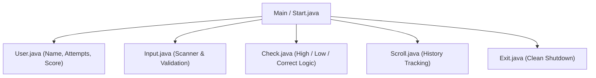

# 🎲 Random Number Guessing Game — Java OOP Console Game

An interactive, object-oriented Java console game where players guess a secret generated number between 1 and 100 with dynamic feedback, guess history tracking, and score calculation.

---

## 📌 Project Overview

This project implements an interactive number guessing game in Java designed to demonstrate core Object-Oriented Programming (OOP) principles:
- **Separation of Concerns:** Each responsibility (user tracking, input handling, guess evaluation, history tracking, game loop) is encapsulated into its own dedicated class.
- **Dynamic Feedback:** Guides the user whether their guess is "Too high" or "Too low".
- **Score & History Tracking:** Tracks player attempt count, maintains a history log of prior guesses (`Scroll`), and calculates the player's final performance score.

---

## 🏗️ Architecture & Class Design



### Class Responsibilities:
- `Start.java`: Orchestrates the main game loop and coordinates between helper classes.
- `User.java`: Encapsulates player data, increments attempts, and tracks score.
- `Input.java`: Handles user keyboard input safely via Java `Scanner`.
- `Check.java`: Compares user guess against the randomly generated secret number.
- `Scroll.java`: Stores and displays the player's previous guesses.
- `Exit.java`: Provides graceful termination and exit messaging.

---

## 📂 Repository Structure

```text
Random_Number_Guessing-Game-/
├── Start.java        # Main game controller and loop
├── User.java         # Player profile and scoring
├── Input.java        # Input handling and parsing
├── Check.java        # Guess verification logic
├── Scroll.java       # Guess history list
├── Exit.java         # Termination handler
├── Random1.jpg       # Gameplay screenshot 1
├── Random2.jpg       # Gameplay screenshot 2
└── README.md         # Project documentation
```

---

## ⚙️ Installation & Execution

### Prerequisites
- Java Development Kit (JDK 8 or higher)

### Steps to Run:

1. **Clone the repository:**
   ```bash
   git clone https://github.com/prakruthidevanga/Random_Number_Guessing-Game-.git
   cd Random_Number_Guessing-Game-
   ```

2. **Compile the classes:**
   ```bash
   javac *.java
   ```

3. **Run the game:**
   ```bash
   java Start
   ```

---

## 🎮 Gameplay Demonstration

1. Enter your name when prompted.
2. Enter your guess (between 1 and 100).
3. Follow the hints (`Too high! Try a lower number.` or `Too low! Try a higher number.`).
4. View your guess history after each turn.
5. Win by guessing the exact number and see your total score!

---

## 👩‍💻 Author & Contributions

- **Author:** Prakruthi B R ([@prakruthidevanga](https://github.com/prakruthidevanga))
- **Role:** Individual developer — designed modular OOP architecture, game loop, and input verification.
