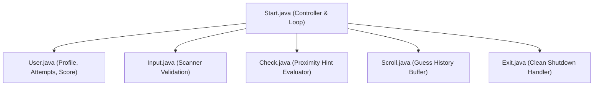

# 🎲 Random Number Guessing Game — Java OOP Architecture

<p align="center">
  
</p>

<p align="center">
  An interactive, object-oriented console game in Java where players guess a secret pseudo-random integer between 1 and 100 with dynamic proximity feedback, attempt history logging, and performance scoring.
</p>

<p align="center">
  <a href="https://github.com/prakruthidevanga/Random_Number_Guessing-Game-">
    
  </a>
</p>

<p align="center">
  
  
  
  
</p>

---

## 📌 Table of Contents

- [📖 Project Overview](#-project-overview)
- [🎯 Objectives](#-objectives)
- [✨ Key Features](#-key-features)
- [🏗️ OOP Class Architecture](#️-oop-class-architecture)
- [🛠️ Technology Stack](#️-technology-stack)
- [📁 Repository Structure](#-repository-structure)
- [⚙️ Compilation and Execution](#️-compilation-and-execution)
- [🎮 Gameplay Walkthrough](#-gameplay-walkthrough)
- [🔮 Future Enhancements](#-future-enhancements)
- [🤝 Contributing](#-contributing)
- [👩‍💻 Author & Accreditations](#-author--accreditations)

---

## 📖 Project Overview

Many introductory programming examples compress game loops, state variables, and input scanners into a single unstructured `main` method. This project takes the opposite approach: applying rigorous **Object-Oriented Programming (OOP) design patterns** and Single Responsibility principles to build an interactive number guessing game.

By distributing gameplay responsibilities across 6 specialized classes (`Start`, `User`, `Input`, `Check`, `Scroll`, `Exit`), the program demonstrates clean class encapsulation, state tracking, and user input validation.

🎲 **Core Mission:** Demonstrate clean object-oriented architecture and modular design through interactive gameplay.

---

## 🎯 Objectives

- 🧩 **Single Responsibility Principle:** Assign distinct responsibilities to individual Java classes.
- 🎯 **Dynamic Feedback Engine:** Compare player guesses against random integers and guide convergence with directional hints.
- 📜 **Historical Telemetry:** Maintain a sequential log of all guesses made during the session (`Scroll`).
- 🛡️ **Robust Input Sanitation:** Validate console inputs gracefully without throwing uncaught runtime exceptions.

---

## ✨ Key Features

### 🎮 1. Modular Controller (`Start.java`)
Orchestrates the lifecycle of the game, managing loop turns and coordinating between helper instances.

### 👤 2. Player Profile & Scoring (`User.java`)
Encapsulates player metadata, increments attempt counters, and computes the final game score.

### 📜 3. Guess History Buffer (`Scroll.java`)
Maintains an internal record of all prior attempts and outputs formatted history tables after each guess.

### 🎯 4. Proximity Hint Evaluator (`Check.java`)
Evaluates guesses against the secret integer and outputs directional hints (`Too high!` / `Too low!`).

---

## 🏗️ OOP Class Architecture



---

## 🛠️ Technology Stack

<p align="center">
  
</p>

| Component | Technology | Implementation Role |
| :--- | :--- | :--- |
| **Language** | Java (JDK 8 or higher) | Core runtime, object-oriented syntax, class structures |
| **Input Handling** | `java.util.Scanner` | Console keyboard reading and validation |
| **RNG Engine** | `java.util.Random` | Pseudo-random integer generation |

---

## 📁 Repository Structure

```text
Random_Number_Guessing-Game-/
├── Start.java        # Main game controller and loop
├── User.java         # Player profile and scoring
├── Input.java        # Input handling and parsing
├── Check.java        # Guess verification logic
├── Scroll.java       # Guess history list
├── Exit.java         # Termination handler
├── Random1.jpg       # Gameplay screenshot 1
├── Random2.jpg       # Gameplay screenshot 2
└── README.md         # Project documentation
```

---

## ⚙️ Compilation and Execution

### Prerequisites
- Java Development Kit (JDK 8 or higher)

### Steps to Run:
```bash
git clone https://github.com/prakruthidevanga/Random_Number_Guessing-Game-.git
cd Random_Number_Guessing-Game-
javac *.java
java Start
```

---

## 🎮 Gameplay Walkthrough

1. Enter your player name when prompted.
2. Enter your guess between 1 and 100.
3. Observe feedback hints (`Too high! Try lower` or `Too low! Try higher`).
4. Review your previous guesses displayed from the `Scroll` history.
5. Win by matching the secret number and view your total attempt efficiency!

---

## 🔮 Future Enhancements

- ⏱️ **Timed Mode:** Implement a countdown timer to test player decision speed.
- 🏆 **Leaderboard Persistence:** Save top scores and player names to a local text/JSON file.

---

## 🤝 Contributing

Contributions and gameplay modes are welcomed! Feel free to open a PR.

---

## 👩‍💻 Author & Accreditations

**Prakruthi B R**  
*BCA Student specializing in Artificial Intelligence & Machine Learning*  
*Alliance University, Bengaluru (CGPA: 9.60)*  
*GeeksforGeeks Campus Mantri (2026)*

- 💻 **GitHub:** [@prakruthidevanga](https://github.com/prakruthidevanga)
- 🔗 **LinkedIn:** [Prakruthi BR](https://linkedin.com/in/prakruthi-br)
- 🌐 **Portfolio:** [prakruthidevanga.github.io](https://prakruthidevanga.github.io/)
- 📬 **Email:** [prakruthibr2006@gmail.com](mailto:prakruthibr2006@gmail.com)

---

<p align="center">
  <b>🎲 Applying software engineering design patterns to interactive problem-solving.</b>
</p>

<p align="center">
  
</p>
